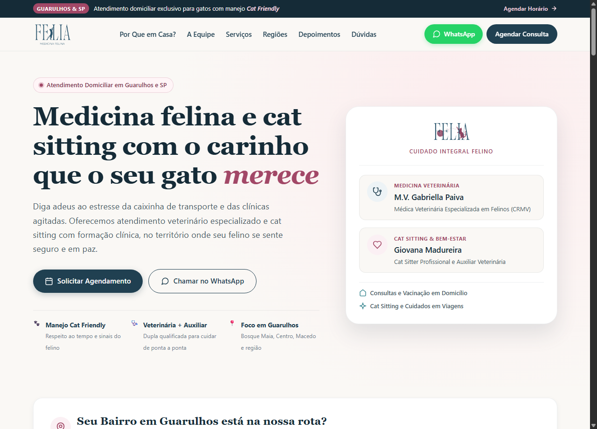
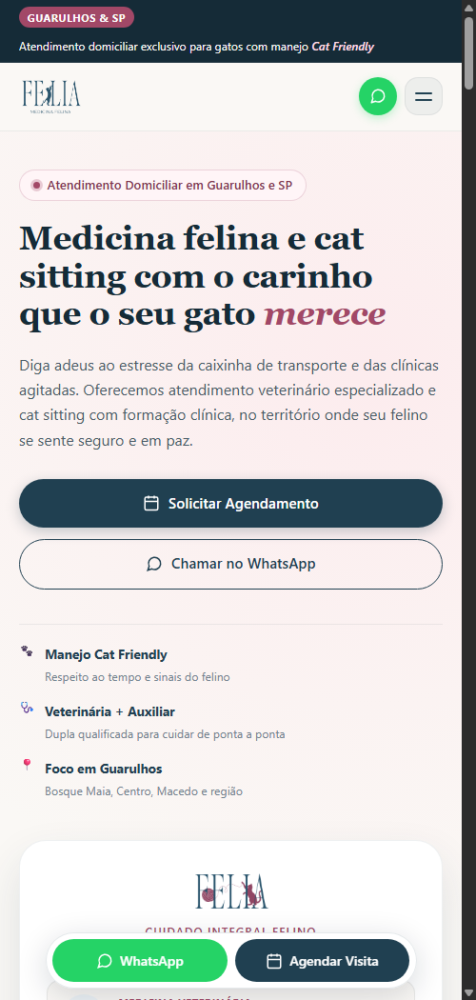

# FELIA - Medicina Felina & Cat Sitting Domiciliar

Website completo e responsivo para captação de leads em **Guarulhos e Região Metropolitana de São Paulo**, desenvolvido para a **Dra. Gabriella Paiva** (Médica Veterinária Especializada em Felinos) e **Giovana Madureira** (Cat Sitter e Auxiliar Veterinária).

🌐 **Site no Ar (GitHub Pages):** [https://giovanipelissoni.github.io/felia-medicina-felina/](https://giovanipelissoni.github.io/felia-medicina-felina/)

---

## 📸 Previews da Versão 2.0 (Redesign Front-End & Mobile)

| Versão Desktop | Versão Mobile (Otimizada) |
| :---: | :---: |
|  |  |

---

## 🎨 Identidade Visual Aplicada (Baseada nos Arquivos Oficiais)

- **Cores Oficiais (Canva & Branding FELIA)**:
  - Fundo Creme / Warm Off-White: `#FAF8F5`
  - Deep Petrol Blue (Autoridade & Títulos): `#204051` / `#152B37`
  - Rosa Queimado / Mauve: `#A24867`
  - Rosa Suave / Blush: `#FFDDE5`
  - Verde WhatsApp: `#25D366`
- **Tipografia**:
  - Títulos & Marca: *Cormorant Garamond* (elegância clássica e autoridade veterinária)
  - Corpo, Badges & Botões: *Outfit* (ultra-limpo, geométrico e altamente legível em telas mobile)
- **Assets Oficiais em Alta Resolução**:
  - `assets/logo-medicina-felina.png`: Logotipo oficial FELIA Medicina Felina para cabeçalho e rodapé.
  - `assets/logo-cat-care.png`: Logotipo de Cat Sitting com o novelo de lã e o gato brincalhão.
  - `assets/pattern-clean.png`: Pattern ilustrado com felinos e folhagens botânicas.

---

## 🚀 Estrutura e Diferenciais da Versão 2.0

1. **Barra de Anúncio Superior de Alto Contraste**: Fundo escuro azul petróleo com tipografia em branco nítido e tag mauve, atendendo aos padrões WCAG AAA de contraste.
2. **Cabeçalho Cirúrgico & Drawer Mobile**:
   - Desktop: Navegação completa com menu de links, botão WhatsApp e CTA de agendamento.
   - Mobile: Logo em alta definição à esquerda, botão circular de WhatsApp e botão de menu hambúrguer com gaveta lateral (*drawer*) animada e acessível.
3. **Hero Section Editorial**:
   - Proposta de valor forte sem clichês.
   - Botões principais verticais em mobile (100% de largura, fáceis de tocar com o polegar).
   - Selos de confiança: *Manejo Cat Friendly*, *Veterinária + Auxiliar*, *Foco em Guarulhos*.
   - Cartão visual das fundadoras destacando o cuidado integral.
4. **Verificador Rápido de Bairros de Guarulhos**:
   - Chips interativos (*Bosque Maia, Centro, Vila Augusta, Macedo, Vila Galvão, Gopoúva, Picanço, Cecap, Jardim Maia, etc.*).
   - Feedback dinâmico instantâneo e preenchimento automático no formulário de agendamento.
5. **Por Que em Casa? (Diferenciais Cat Friendly)**:
   - Fim da caixinha de transporte e estresse do trânsito.
   - Sem latidos de cães ou odores de outros animais em pânico.
   - Diagnóstico clínico mais preciso (sem hiperglicemia por estresse).
   - Consultas acolhedoras de 50 a 80 minutos.
6. **Sobre Nós (A Dupla de Especialistas)**:
   - Perfil da **M.V. Gabriella Paiva** (CRMV Ativo - protocolos ISFM).
   - Perfil da **Giovana Madureira** (Cat Sitter Profissional & Auxiliar Veterinária).
   - Banner de sinergia explicando o grande diferencial de atendimento médico e rotina combinados.
7. **Nossos Serviços com Filtro por Categoria**:
   - Abas dinâmicas: *Todos os Serviços*, *Medicina Veterinária*, *Cat Sitting*, *Medicação & Exames*.
   - Botões de ação em cada cartão que selecionam o serviço e rolam suavemente até o formulário.
8. **Regiões de Atendimento Detalhadas**:
   - Guarulhos (rota prioritária) e São Paulo Capital (Zona Norte e Leste).
9. **Ficha de Pré-Agendamento & WhatsApp Dispatch**:
   - Validação de dados, campos de data, período e observações.
   - Máscara automática para telefone: `(11) 98765-4321`.
   - Armazenamento local no navegador (`localStorage`).
   - Botão para envio da mensagem 100% pronta e formatada para o WhatsApp da equipe.
10. **Depoimentos de Tutores & FAQ**:
    - Prova social com avaliações 5 estrelas.
    - Acordeão animado com dúvidas frequentes sobre consultas, cat sitting e formas de pagamento.
11. **Cápsula Flutuante Inferior no Celular (Bottom Dock)**:
    - Barra moderna estilo vidro (*glassmorphism*) fixa na base do celular com botões de *WhatsApp* e *Agendar Visita* sempre ao alcance do dedo.

---

## 📅 Integração com o Google Calendar

Consulte o arquivo [`INTEGRACAO_GOOGLE_CALENDAR.md`](INTEGRACAO_GOOGLE_CALENDAR.md) para o passo a passo completo sobre como integrar a agenda compartilhada da Gabriella e da Giovana.
